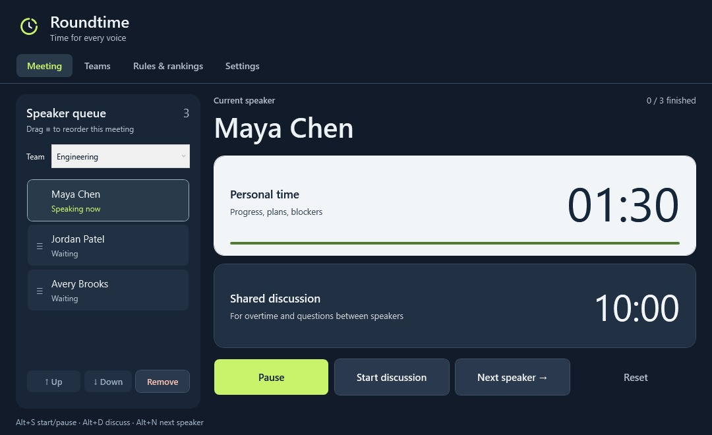
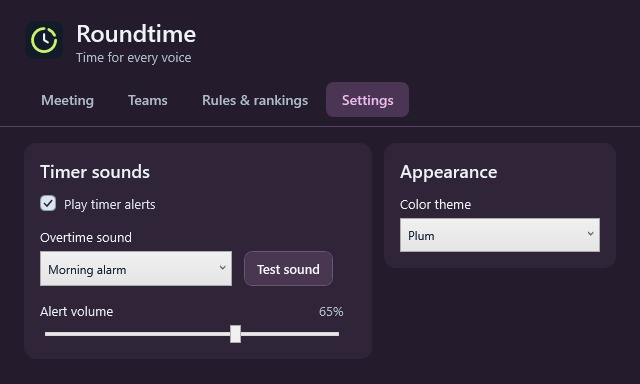

# Roundtime

A standup timer for Windows with saved team rosters. By default, each speaker gets **1:30** and the team shares **10:00** for discussion.

[Download for Windows (.zip)](https://github.com/achvanov7/Roundtime/releases/latest/download/Roundtime-Windows.zip)

Extract the ZIP and open `Roundtime.exe` from the extracted folder. Requires .NET Framework 4.8 or later.

Recent builds are also available under **Artifacts** on successful runs. [Windows build workflow](https://github.com/achvanov7/Roundtime/actions/workflows/windows-build.yml)

## Run a standup

1. Add your team and speakers in **Teams**. Use **Personal time** to give someone a different speaking limit.
2. Open **Meeting**, choose a team, and select **Start meeting**.
3. Select **Start discussion** to switch to shared time early. Discussion also starts when the speaker’s time runs out.
4. Select **Next speaker** to advance and **Finish meeting** after the last turn.

Reorder or skip speakers in **Meeting** for the current standup. Edit the saved roster in **Teams**.

## Settings and rankings

- **Rules & rankings** lets you change timer lengths, keep the window on top, and see how often each speaker runs out of time.
- **Settings** lets you choose a color theme, select an overtime sound, and adjust the volume. Use **Test sound** to hear the selected alert.

Roundtime saves your rosters, rankings, and preferences in `%LOCALAPPDATA%\Roundtime\settings.json`. To carry them over from an older install, copy its `settings.json` there before opening the updated app.
