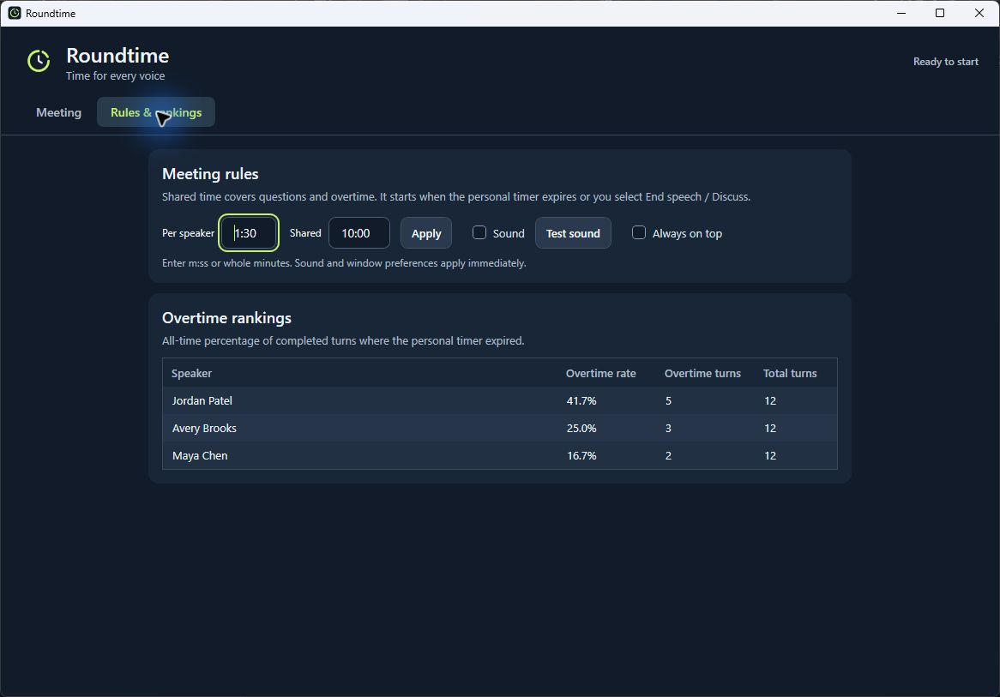

# Roundtime

[Download Roundtime for Windows (.zip)](https://github.com/achvanov7/Roundtime/releases/latest/download/Roundtime-Windows.zip)

A Windows standup timer built with C# and WPF. Each speaker gets **1:30** by default. A shared **10:00** allowance covers overtime and clarifying questions between speakers.


## Run

On GitHub, open a successful **Windows build** run under **Actions** and download `Roundtime-Windows.zip` from **Artifacts**. Extract the ZIP and open `Roundtime.exe`.

Double-click `artifacts\Roundtime\Roundtime.exe`. Keep `DailyTimer.Core.dll` and `Roundtime.exe.config` alongside it. The application targets **.NET Framework 4.8**; there are no third-party packages or runtime network calls. No installer is needed.

For another Windows computer, copy the three application files together or extract the provided Windows ZIP before opening the executable. Windows needs .NET Framework 4.8 or later installed.

## Run a meeting

1. Type a name and press **Enter** or **Add**. Click a name in the queue to edit it; leave the field or press Enter to save.
2. Reorder waiting speakers using their **≡** drag handle, **Up/Down**, or **Shuffle remaining speakers**. Select a row to remove an absent person. Once started, completed and current speakers stay fixed while the waiting queue can change.
3. Press **Start meeting**. The personal allowance counts down.
4. When personal time expires, a two-note alert plays and the shared allowance starts automatically. **End speech / Discuss** starts shared time early for questions; unused personal time is not added to the shared budget.
5. Press **Next speaker** to stop consuming shared time and start the next person's full personal allowance. You can also advance before any discussion.
6. **Pause/Resume** affects both timers. Advancing while paused keeps the next slot paused.
7. Shared expiry plays a different alert and shows negative overtime. The meeting can continue. After the last discussion, press **Finish meeting**.
8. **Reset** restores the allowances and marks everyone waiting, preserving the roster and order.

Removing the active speaker asks for confirmation and advances to the next waiting person. Adding someone after a meeting has finished includes them in the next meeting after Reset.

## Overtime rankings

Open **Rules & rankings** to see speakers sorted by their all-time overtime percentage, with overtime turns and total completed turns alongside it. A turn counts as overtime when the personal timer reaches zero. Starting discussion before it reaches zero counts as on time, regardless of how long discussion lasts.



**Next speaker** and **Finish meeting** record the current turn. Rankings carry over between meetings and app launches. Removing a speaker from the queue keeps their history. Adding them back under the same name restores their history when there is a single match.

## Settings

Use **Meeting rules** on the **Rules & rankings** tab to change personal and shared durations, toggle sounds, test the personal alert, or keep the window on top. Enter `m:ss` or whole minutes, then select **Apply**. The personal allowance supports 1 second to 60 minutes. The shared allowance supports 1 second to 240 minutes. During a meeting, duration changes apply after Reset. Sound and window preferences apply immediately.

The roster, order, allowances, and preferences are saved per Windows user in `%LOCALAPPDATA%\DailyTimer\settings.json`. Roundtime keeps this original data location so existing DailyTimer rosters and preferences continue to work. Relaunch starts a fresh, paused meeting. Live progress is not restored. A damaged or inaccessible file produces a notice and usable defaults; the app does not overwrite an unreadable file until you deliberately change something.

Optional isolated settings file for testing:

```powershell
.\artifacts\Roundtime\Roundtime.exe --settings C:\path\to\test-settings.json
```

Keyboard shortcuts: **Alt+S** start/pause/resume, **Alt+D** discuss, **Alt+N** next/finish.

On small screens or at high Windows display scaling, the initial window fits the available desktop. Scrollbars keep the entire workspace accessible when the window is reduced below its comfortable layout size; keyboard focus also brings controls into view.

## Build and test without downloads

From this directory in PowerShell:

```powershell
.\build.ps1 -Test
```

The script uses the installed .NET Framework C# compiler, treats warnings as errors, runs a dependency-free behavioral test executable, and produces `artifacts\Roundtime\Roundtime.exe`. It does not require a .NET SDK, NuGet restore, administrator rights, or internet access. Close the application before rebuilding.

`build.ps1 -Run` builds and launches the app. To create a portable ZIP after building:

```powershell
.\package.ps1
```

The output is `artifacts\Roundtime-Windows.zip`. Source is also available as a conventional SDK-style solution (`DailyTimer.sln`, with the application shown as Roundtime) for Visual Studio with the .NET desktop workload and .NET Framework 4.8 targeting pack. That SDK build route requires an SDK/targeting pack and was not available in the original build environment; the PowerShell build is the verified offline route.

The Roundtime icon is embedded in the executable for File Explorer, the window title bar, and the Windows taskbar. The app header uses the matching vector mark. Edit `src/DailyTimer.App/Assets/Roundtime.Mark.xaml`, then run `tools/Render-AppIcon.ps1` before rebuilding to regenerate the multi-resolution Windows icon and PNG preview.

## Code layout

- `src/DailyTimer.Core`: meeting state machine, stable speaker identities, and validated atomic JSON persistence.
- `src/DailyTimer.App`: WPF window, controls, and generated audio alerts. XAML is embedded and loaded at runtime.
- `tests/DailyTimer.Tests`: fake-clock and persistence tests, plus WPF layout checks for long durations and a 640×480 logical work area. The tests use no external test framework.

Elapsed time is measured with a monotonic stopwatch. A delayed UI refresh does not lose overtime. Explicit pauses exclude elapsed time; computer suspension may advance the stopwatch, and the app accounts for that on resume. It cannot sound an alarm while Windows is asleep.
