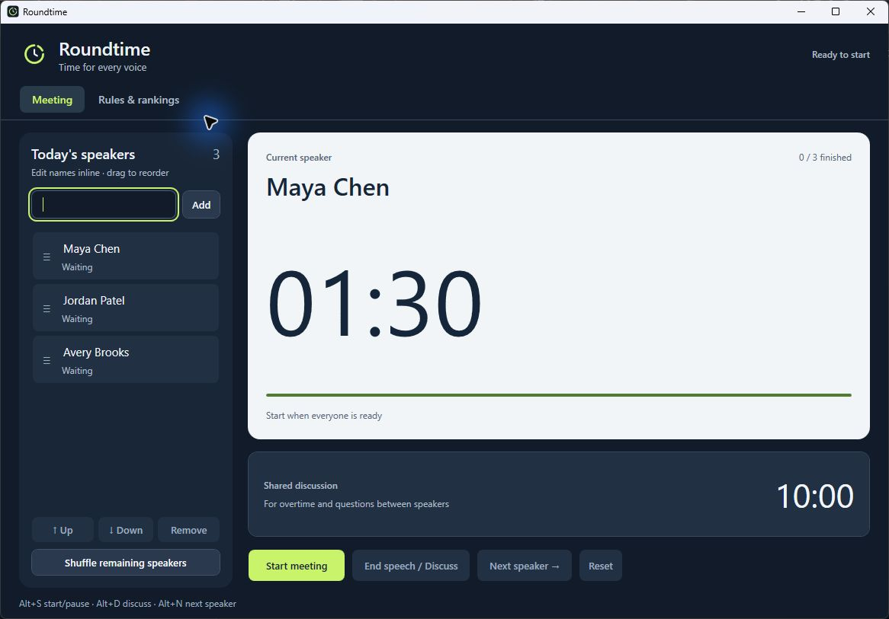

# Roundtime

[Download Roundtime for Windows (.zip)](https://github.com/achvanov7/Roundtime/releases/latest/download/Roundtime-Windows.zip)

A Windows standup timer built with C# and WPF. Keep a saved roster for each team and choose which one to run. Speakers get **1:30** by default, with a shared **10:00** allowance for discussion and overtime.



## Run

On GitHub, open a successful **Windows build** run under **Actions** and download `Roundtime-Windows.zip` from **Artifacts**. Extract the ZIP and open `Roundtime.exe`.

Double-click `artifacts\Roundtime\Roundtime.exe`. Keep `DailyTimer.Core.dll` and `Roundtime.exe.config` alongside it. The application targets **.NET Framework 4.8**; there are no third-party packages or runtime network calls. No installer is needed.

For another Windows computer, copy the three application files together or extract the provided Windows ZIP before opening the executable. Windows needs .NET Framework 4.8 or later installed.

## Teams and saved rosters

Open **Teams** to create, rename, or delete teams. Select a team to add, rename, or remove people from its saved roster. Drag a speaker's **≡** handle or use **Up/Down** to save a new order. While dragging, the speaker's name follows the pointer and a green line marks where they will land.

To give someone a custom speaking time, select their name and enter `30` or `0:30` in **Personal time** for a 30-second turn. Press **Enter** or choose **Save speaker** and look for the save confirmation. A blank field uses the meeting default.

An existing single roster and its overtime history migrate to **Default team**. Roundtime remembers the last team you selected.

## Run a meeting

1. On **Meeting**, choose a team and press **Start meeting**. The current speaker appears first, and the personal timer takes the highlighted top position.
2. Select **Start discussion** to switch to shared time early. Personal time expiry also starts discussion automatically and plays an alert. The shared timer moves to the top during discussion.
3. If the speaker has personal time left, **Back to speaker** resumes their turn and keeps the remaining shared balance. **Pause/Resume** works in either phase.
4. Choose **Next speaker** to advance. Finished speakers leave the visible queue, and the next speaker gets their own full allowance. If shared time expires, the timer shows negative overtime and the meeting can continue. Choose **Finish meeting** after the last turn.

Drag or use **Up/Down** to reorder waiting speakers, or select **Remove** to skip someone for this meeting. Removing the active speaker asks for confirmation and advances to the next waiting person. Long queues scroll within the speaker list.

Queue changes on **Meeting** apply only to that meeting. **Reset** restores the timers and reloads the saved roster, including any team or speaker changes you saved during the meeting. You can switch teams before starting or after finishing.

## Overtime rankings

Open **Rules & rankings** to see speakers sorted by their all-time overtime percentage, with overtime turns and total completed turns alongside it. A turn counts as overtime when the personal timer reaches zero. Starting discussion before it reaches zero counts as on time, regardless of how long discussion lasts.


**Next speaker** and **Finish meeting** record the current turn. Rankings identify each speaker's team and carry over between meetings and app launches. Removing a speaker keeps their history. Adding them back to the same team under the same name restores their history when there is a single match.

## Settings

Use **Meeting rules** on the **Rules & rankings** tab to change personal and shared durations, toggle sounds, test the personal alert, or keep the window on top. Enter `m:ss` or whole minutes, then select **Apply**. The personal allowance supports 1 second to 60 minutes. The shared allowance supports 1 second to 240 minutes. During a meeting, duration changes apply after Reset. Sound and window preferences apply immediately.

Teams, saved rosters, the selected team, allowances, and preferences are saved per Windows user in `%LOCALAPPDATA%\DailyTimer\settings.json`. Relaunch loads the selected team's saved roster for a fresh meeting. A damaged or inaccessible file produces a notice and usable defaults. Roundtime waits for a deliberate change before overwriting an unreadable file.

Optional isolated settings file for testing:

```powershell
.\artifacts\Roundtime\Roundtime.exe --settings C:\path\to\test-settings.json
```

Keyboard shortcuts: **Alt+S** start/pause/resume, **Alt+D** discuss, **Alt+N** next/finish.

On small screens or at high Windows display scaling, the initial window fits the available desktop. Scrollbars keep the entire workspace accessible when the window is reduced below its comfortable layout size; keyboard focus also brings controls into view.

## Build and test without downloads

From this directory in PowerShell:

```powershell
.\build.ps1 -Test
```

The script uses the installed .NET Framework C# compiler, treats warnings as errors, runs a dependency-free behavioral test executable, and produces `artifacts\Roundtime\Roundtime.exe`. It does not require a .NET SDK, NuGet restore, administrator rights, or internet access. Close the application before rebuilding.

`build.ps1 -Run` builds and launches the app. To create a portable ZIP after building:

```powershell
.\package.ps1
```

The output is `artifacts\Roundtime-Windows.zip`. Source is also available as a conventional SDK-style solution (`DailyTimer.sln`, with the application shown as Roundtime) for Visual Studio with the .NET desktop workload and .NET Framework 4.8 targeting pack. That SDK build route requires an SDK/targeting pack and was not available in the original build environment; the PowerShell build is the verified offline route.

The Roundtime icon is embedded in the executable for File Explorer, the window title bar, and the Windows taskbar. The app header uses the matching vector mark. Edit `src/DailyTimer.App/Assets/Roundtime.Mark.xaml`, then run `tools/Render-AppIcon.ps1` before rebuilding to regenerate the multi-resolution Windows icon and PNG preview.

## Code layout

- `src/DailyTimer.Core`: meeting state machine, stable speaker identities, and validated atomic JSON persistence.
- `src/DailyTimer.App`: WPF window, controls, and generated audio alerts. XAML is embedded and loaded at runtime.
- `tests/DailyTimer.Tests`: fake-clock, persistence, and WPF tests for roster isolation, custom durations, and layout in a 640×480 logical work area. The tests use no external test framework.

Elapsed time is measured with a monotonic stopwatch. A delayed UI refresh does not lose overtime. Explicit pauses exclude elapsed time; computer suspension may advance the stopwatch, and the app accounts for that on resume. It cannot sound an alarm while Windows is asleep.
